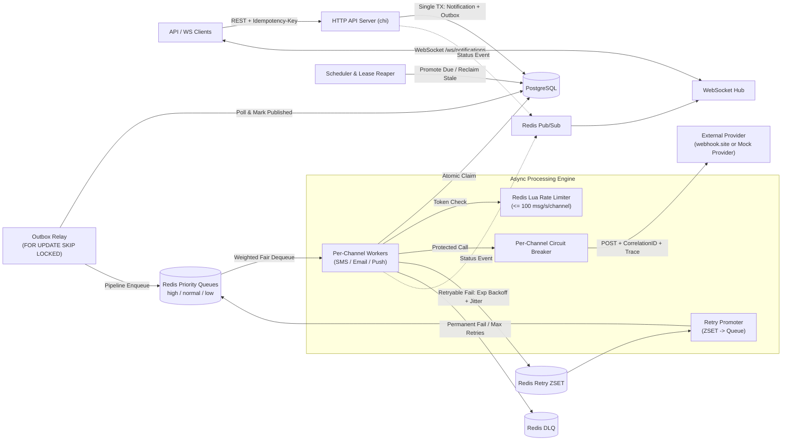

# Event-Driven Notification System (Go)

A scalable, event-driven multi-channel notification platform built in **Go** for **SMS**, **Email**, and **Push** delivery. Designed for burst traffic, reliable delivery, distributed per-channel rate limiting (**max 100 msg/s/channel**), full observability, and clean horizontal scalability.

---

## Key Capabilities

### Core Functional Requirements
- **Notification Management REST API**
  - Create single notifications (`recipient`, `channel`, `content`, `priority`)
  - Atomic **batch creation** (up to **1,000 notifications** per request in a single PostgreSQL transaction)
  - Query notification status & delivery attempt audit history by ID or aggregated status by **batch ID**
  - Atomically **cancel** pending, scheduled, queued, or retrying notifications
  - List notifications with dynamic filtering (`status`, `channel`, `priority`, `batch_id`, `from`, `to`) and pagination
- **Asynchronous Processing Engine**
  - Dedicated per-channel worker pools (`sms`, `email`, `push`) with graceful SIGTERM draining
  - **Distributed Rate Limiting**: Redis Lua sliding-window rate limiter strictly enforcing **≤ 100 messages/second per channel** globally across all workers and replicas
  - **Priority Queues (`high`, `normal`, `low`)** with weighted fair dequeue (6:3:1 anti-starvation fallback)
  - **Channel-Aware Validation** (E.164 SMS phone + 1,600 char limit, RFC 5322 Email + 10,000 char limit, Push device token + 4,096 char limit)
  - **End-to-End Idempotency**: `Idempotency-Key` header + payload hash check at the API layer, unique constraints in PostgreSQL, and atomic DB claiming in workers for effectively-once delivery
- **Delivery, Reliability & Retry Design**
  - **Transactional Outbox Pattern**: Notifications and outbox records are written in one PostgreSQL transaction; an `OutboxRelay` using `SELECT ... FOR UPDATE SKIP LOCKED` guarantees zero lost messages even if Redis restarts
  - **Smart Error Classification**: Retries transient failures (`5xx`, `429` honoring `Retry-After`, `408`, network/timeouts) and immediately dead-letters permanent `4xx` errors
  - **Exponential Backoff with Equal Jitter** (`base * 2^(attempt-1)` capped at `max_backoff`) backed by Redis Delayed Retry ZSETs
  - **Per-Channel Circuit Breaker** (`Closed → Open → Half-Open`) isolating downstream provider outages without burning notification retry attempts
  - **Dead Letter Queue (DLQ)** + immutable `notification_attempts` audit log + manual `POST /api/v1/notifications/{id}/retry` replay
  - **Stale Lease Recovery**: Automatically reclaims notifications stuck in `processing` if a worker crashes mid-flight
- **Observability**
  - Real-time JSON metrics (`GET /api/v1/metrics`: queue depth per channel/priority/retry/DLQ, success/failure rates, avg & p95 latency, circuit breaker states)
  - Prometheus exposition (`GET /metrics`)
  - Structured JSON logging (`log/slog`) with `X-Correlation-ID` and OpenTelemetry `trace_id`/`span_id`
  - Liveness (`GET /health`) & Readiness (`GET /ready`) probes checking PostgreSQL and Redis

### Bonus Features Included
- **Scheduled Notifications**: Future `scheduled_at` delivery promoted atomically by a background scheduler
- **Template System**: Full CRUD + preview API with safe `{{variable}}` substitution and missing-variable validation
- **Real-Time WebSocket Updates**: `GET /ws/notifications` backed by Redis Pub/Sub with optional `notification_id`, `batch_id`, and `channel` filters
- **Distributed Tracing**: OpenTelemetry W3C `TraceContext` propagation across HTTP → PostgreSQL Outbox → Redis Queue → Worker → Webhook HTTP call (Jaeger UI included in Docker Compose)
- **Interactive API Docs**: Embedded OpenAPI 3.0.3 specification (`GET /openapi.yaml`) and Swagger UI (`GET /docs`)
- **GitHub Actions CI/CD**: Automated `go vet`, `golangci-lint`, race-enabled test suite, and multi-target Docker builds

---

## Architecture Overview



---

## Quick Start (One-Command Setup)

### 1. Start the Full Stack with Docker Compose
```bash
docker compose up --build
```
This boots:
- **Notification System (`app`)**: `http://localhost:8080` (auto-runs versioned SQL migrations)
- **Interactive Swagger UI**: `http://localhost:8080/docs`
- **Built-in Mock Webhook Provider**: `http://localhost:8081/webhook` (returns HTTP `202 Accepted` matching `webhook.site` format out of the box)
- **PostgreSQL 16**: `localhost:5432`
- **Redis 7**: `localhost:6379`
- **Jaeger Tracing UI**: `http://localhost:16686`

### 2. Switch to Real `webhook.site`
Create a unique URL at [webhook.site](https://webhook.site), configure its custom response status to `202` and body to:
```json
{ "messageId": "{{$guid}}", "status": "accepted", "timestamp": "{{$isoTimestamp}}" }
```
Then pass your URL via environment variable (or `.env` copied from `.env.example`):
```bash
WEBHOOK_URL=https://webhook.site/<your-uuid> docker compose up --build
```

---

## API Usage Examples

### Create a Single Notification (with Idempotency Key)
```bash
curl -s -X POST http://localhost:8080/api/v1/notifications \
  -H "Content-Type: application/json" \
  -H "Idempotency-Key: order-confirm-1001" \
  -H "X-Correlation-ID: req-demo-001" \
  -d '{
    "recipient": "+905551234567",
    "channel": "sms",
    "content": "Your Insider One flash sale starts now!",
    "priority": "high"
  }' | jq .
```

### Create a Batch (up to 1,000 Notifications)
```bash
curl -s -X POST http://localhost:8080/api/v1/notifications/batch \
  -H "Content-Type: application/json" \
  -H "Idempotency-Key: campaign-batch-42" \
  -d '{
    "notifications": [
      {"recipient": "+905551234567", "channel": "sms", "content": "Flash sale SMS", "priority": "high"},
      {"recipient": "ada@example.com", "channel": "email", "content": "Flash sale Email", "priority": "normal"},
      {"recipient": "fcm_device_token_987654321", "channel": "push", "content": "Flash sale Push", "priority": "low"}
    ]
  }' | jq .
```

### Query by Notification ID or Batch ID
```bash
curl -s http://localhost:8080/api/v1/notifications/<notification-id> | jq .
curl -s http://localhost:8080/api/v1/notifications/batches/<batch-id> | jq .
```

### List Notifications with Filtering & Pagination
```bash
curl -s "http://localhost:8080/api/v1/notifications?status=delivered&channel=sms&page=1&page_size=20" | jq .
```

### Create a Scheduled Notification & Cancel It
```bash
ID=$(curl -s -X POST http://localhost:8080/api/v1/notifications \
  -H "Content-Type: application/json" \
  -d '{
    "recipient": "user@example.com",
    "channel": "email",
    "content": "Scheduled reminder",
    "scheduled_at": "2027-01-01T10:00:00Z"
  }' | jq -r '.id')

curl -s -X POST "http://localhost:8080/api/v1/notifications/${ID}/cancel" | jq .
```

### Create & Use a Message Template
```bash
TPL_ID=$(curl -s -X POST http://localhost:8080/api/v1/templates \
  -H "Content-Type: application/json" \
  -d '{
    "name": "otp-sms",
    "channel": "sms",
    "body": "Hello {{name}}, your verification code is {{code}}."
  }' | jq -r '.id')

curl -s -X POST http://localhost:8080/api/v1/notifications \
  -H "Content-Type: application/json" \
  -d "{
    \"recipient\": \"+905551234567\",
    \"channel\": \"sms\",
    \"template_id\": \"${TPL_ID}\",
    \"template_vars\": {\"name\": \"Berke\", \"code\": \"482910\"},
    \"priority\": \"high\"
  }" | jq .
```

### Real-Time Observability & WebSocket Stream
```bash
# Real-time JSON metrics (queue depth, success/failure rates, avg/p95 latency, circuit breakers)
curl -s http://localhost:8080/api/v1/metrics | jq .

# Prometheus metrics
curl -s http://localhost:8080/metrics

# Health & readiness
curl -s http://localhost:8080/health | jq .
curl -s http://localhost:8080/ready | jq .

# Live WebSocket stream (optional filters: ?channel=sms&batch_id=...&notification_id=...)
websocat "ws://localhost:8080/ws/notifications?channel=sms"
```

---

## Project Structure

```text
.
├── .github/workflows/ci.yml        # Automated vet, golangci-lint, test -race, Docker build
├── api/openapi.yaml                # Embedded OpenAPI 3.0.3 specification
├── cmd/
│   ├── server/main.go              # Entrypoint supporting APP_MODE=all|api|worker
│   └── mockprovider/main.go        # Local webhook.site-compatible 202 provider simulator
├── internal/
│   ├── api/                        # HTTP router, middlewares, DTOs, REST/WS/Docs handlers
│   ├── config/                     # Typed environment configuration & validation
│   ├── domain/                     # Core entities, state machine, channel validators, templates
│   ├── observability/              # JSON slog logger, Prometheus + JSON metrics, OTel tracing
│   ├── provider/                   # Webhook HTTP client, error classifier, per-channel circuit breaker
│   ├── queue/                      # Redis weighted priority queues, retry ZSET, DLQ, Lua rate limiter
│   ├── realtime/                   # Redis Pub/Sub WebSocket fan-out hub
│   ├── repository/postgres/        # pgxpool, embedded SQL migrator, transactional repositories
│   ├── service/                    # Notification & template application business logic
│   └── worker/                     # Worker engine, outbox relay, scheduler, retry backoff processor
├── migrations/                     # Versioned SQL schema migrations (000001..000003 up/down)
├── tests/integration/              # End-to-end async pipeline & live Docker integration tests
├── Dockerfile                      # Multi-stage alpine non-root build (server + mockprovider)
├── docker-compose.yml              # One-command Postgres, Redis, Jaeger, mock-provider, app
└── Makefile                        # Common dev/test/docker commands
```

---

## Running Tests

### Single-Command Test Suite (No External Services Required)
```bash
make test
# runs: go test -race -count=1 ./...
```
Runs all unit, component (`miniredis`, `httptest`), and full end-to-end async pipeline tests with Go's race detector enabled.

### Live Integration Tests (Against Docker Compose PostgreSQL + Redis)
```bash
docker compose up -d --build
make test-integration
```

### Horizontal Scaling Modes
The server binary supports `APP_MODE`:
- `APP_MODE=all` (default): Runs both HTTP API / WebSocket server and async worker pools
- `APP_MODE=api`: Stateless API & WebSocket tier only
- `APP_MODE=worker`: Dedicated async queue consumer & outbox/scheduler worker tier (rate limits and outbox locking coordinate safely across replicas via Redis Lua & Postgres `SKIP LOCKED`)
